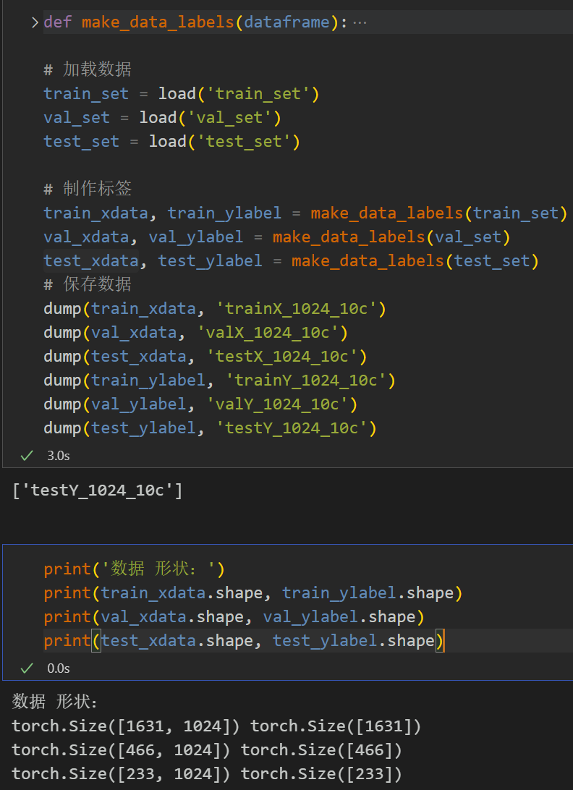
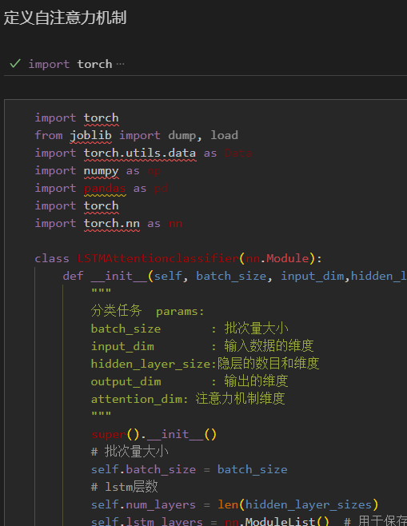
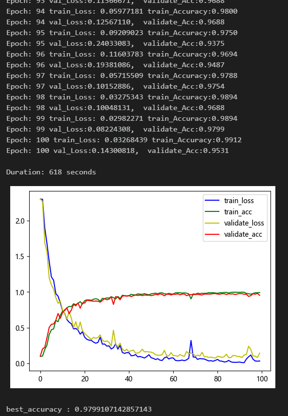
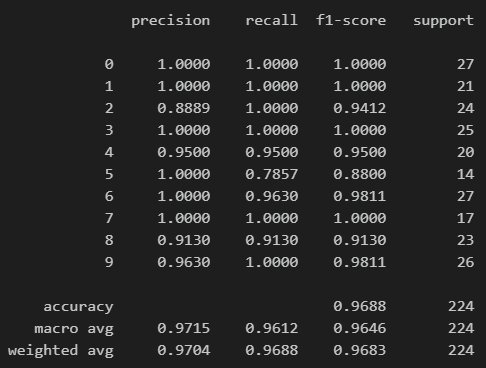
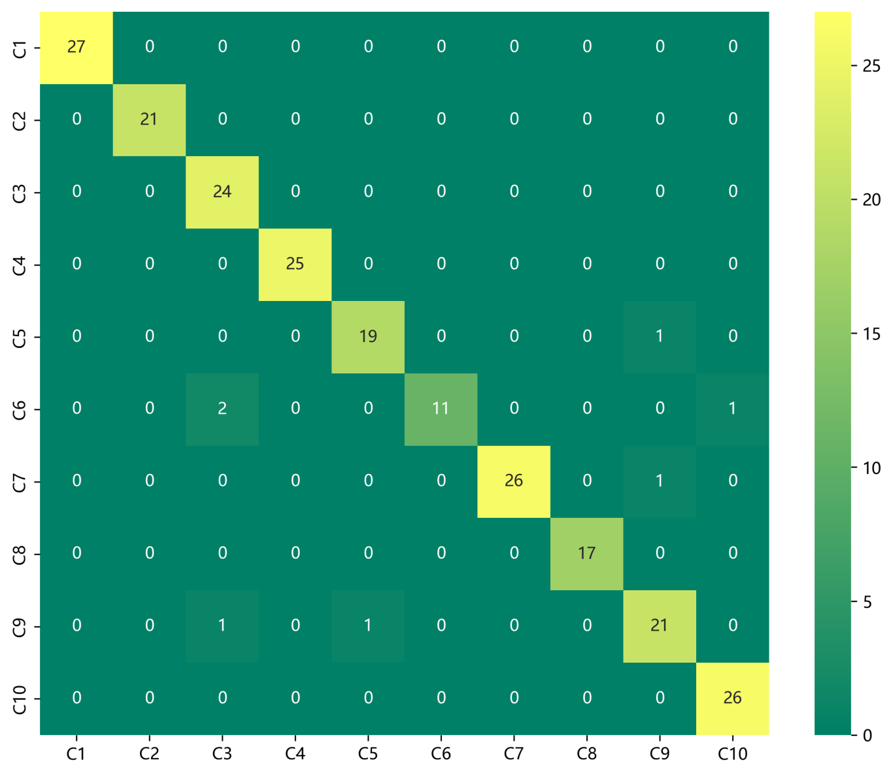
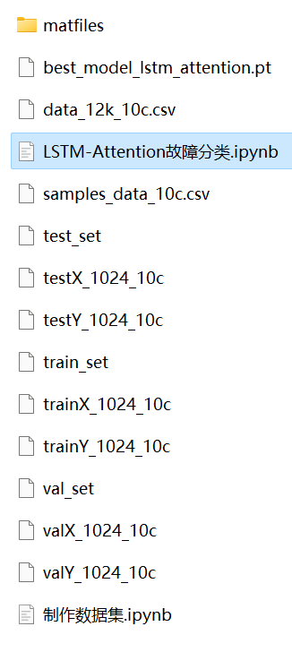

# Bear Fault Diagnosis - LSTM-Attention Fault Classification Model

Including the complete CWRU bearing fault dataset, as well as the fault signal dataset, classification data, and label set that have been generated and ready for use.
50 epochs, accuracy of 98%, the classification effect of LSTM-Attention network is significant. The model can fully extract spatial and temporal features as well as frequency domain features of bearing fault signals, with fast convergence speed and superior performance, high precision. Innovation also exists!!!
Includes code for data preprocessing and LSTM-Attention classification.
Environment: Python 3.9, PyTorch 1.8 and above.
Preface
This paper is based on the bearing data from Case Western Reserve University (CWRU), which first undergoes data preprocessing to create and load the dataset, and finally implements an LSTM-Attention model using Pytorch for the classification of fault data. For a detailed introduction to the bearing data from CWRU, please refer to the following article:
Python-Case Western Reserve University (CWRU) Bearing Data Interpretation and Classification Process
1. Bearing Data Loading and Preprocessing
1.1 Import data
Refer to the previous article for preprocessing of fault classification 10, and the Case Western Reserve University bearing data set: Classification 10 dataset.
\ttrain_set, val_set, test_set are all divided into training set, validation set and test set according to the ratio of 7:2:1, and finally save data.
The above figure illustrates the data reading format and preprocessing approach.
1.2 Data preprocessing, dataset preparation
\t  
2. LSTM-Attention Diagnosis Model Based on Pytorch
2.1 Define the LSTM-Attention classification network model
2.2 Set parameters and train the model
50 epochs, with an accuracy nearing 98%, the LSTM-Attention network achieves significant classification results. The LSTM-Attention model can fully extract multi-scale features of bearing fault signals, has a fast convergence speed, and is particularly outstanding in performance, with noticeable effects.

Note to adjust parameters:
- You may increase the number of LSTM layers and the dimensionality per layer, and fine-tune the learning rate;
- Fine-tune the attention dimensionality, increasing more epochs (be cautious to prevent overfitting);
- Change the shape of one-dimensional signal stacking (set appropriate length and dimension);
- 2.3 Model evaluation
- Accuracy, Precision, Recall, F1 Score
- Fault classification confusion matrix:
- Previously excellent content:
- Python-Case Western Reserve University (CWRU) bearing data interpretation and classification processing
- Python bearing fault diagnosis (I) Short-time Fourier Transform STFT
- Python bearing fault diagnosis (II) Continuous Wavelet Transform CWT
- Python bearing fault diagnosis (III) Empirical Mode Decomposition EMD
- Pytorch-LSTM bearing fault one-dimensional signal classification (I)
- Pytorch-CNN bearing fault one-dimensional signal classification (II)
- Pytorch-Transformer bearing fault one-dimensional signal classification (III)
- Python bearing fault diagnosis (IV) Based on EMD-CNN fault classification
- Python bearing fault diagnosis (V) Based on EMD-LSTM fault classification
- Python bearing fault diagnosis (VI) Based on EMD-Transformer fault classification
- Python bearing fault diagnosis (VII) Based on EMD-CNN-LSTM fault classification
- Python bearing fault diagnosis (VIII) Based on EMD-CNN-GRU parallel model fault classification
Bearing Fault Identification Model Based on FFT + CNN - BiGRU-Attention for Time-Domain and Frequency-Domain Feature Attention Fusion
Bearing Fault Identification Model Based on FFT + CNN - Transformer Time-Domain and Frequency-Domain Feature Fusion
Python Bearing Fault Diagnosis (IX) Fault Classification Based on VMD+CNN-BiLSTM
Python Bearing Fault Diagnosis (10) Failure Classification Based on VMD+CNN-Transformer
Python Bearing Fault Diagnosis (11) Based on VMD+CNN-BiGRU-Attenion for Fault Classification
Cross Attention FFT + CNN - BiLSTM-CrossAttention Bearing Fault Identification Model
Cross Attention Fusion of Time-Domain and Frequency-Domain Features for Bearing Failure Identification Model with FFT + CNN-Transformer-CrossAttention
Python Bearing Fault Diagnosis Beginner Tutorial
Python Bearing Fault Diagnosis (13) Super-strong Machine Learning Recognition Model Based on Fault Signal Feature Extraction
Python Bearing Fault Diagnosis (14) High-Innovation Fault Identification Model
Python Bearing Fault Diagnosis (15) One-Dimensional Fault Signal Recognition Model Based on CNN-Transformer
Python Bearing Fault Diagnosis (16) High-Innovation Fault Identification Model (II)
| Sci 1 Zone High-Innovation Bearing Fault Diagnosis Model!
Python Bearing Fault Diagnosis (18) - Innovative Diagnosis Model Based on CNN-TCN-Attention
High-Innovation Bearing Fault Diagnosis Model Based on GADF+Swin-CNN-GAM
Attention Magic Mod | Superb Bearing Fault Diagnosis Model!
END  
2. Friends who enjoy this can click to follow, give the article a "like", share on social media or discuss in groups.

## Images

<!-- PAYMENT_BLOCK -->

## Get this dataset

- Payment link (Stripe): [Buy now](https://buy.stripe.com/3cs8yP7sY87d0vu9AB)
- Payment QR code: 

<!-- /PAYMENT_BLOCK -->
